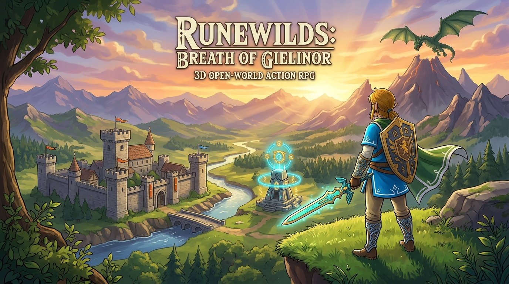
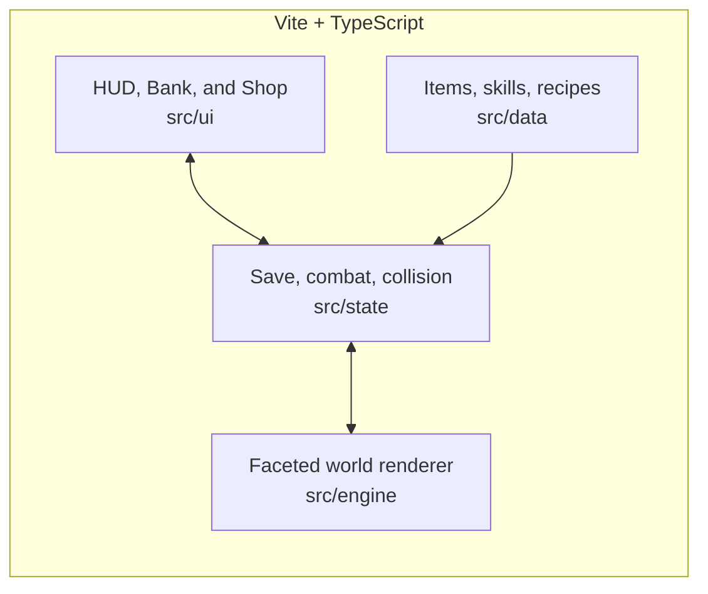

<div align="center">



# Gielinor Hero

**A 3D open-world action RPG**  
*OldSchool RuneScape mechanics and progression in a Breath of the Wild gouache world*

[](https://gielinor-hero.vercel.app/)
[](https://gielinor-hero.vercel.app/)
[](https://threejs.org/)
[-f59e0b?style=for-the-badge)](#item--equipment-progression-261-items--36-matched-sets)
[](./LICENSE)

[**Play Live in Browser**](https://gielinor-hero.vercel.app/) • [**Features**](#key-features) • [**World Regions**](#world-regions--monsters) • [**Controls**](#controls--quick-start) • [**Architecture**](#engine-architecture)

</div>

---

## Overview

**Gielinor Hero** is a 3D open-world RPG. The Vite + TypeScript client keeps the procedural GLSL sky and water, vector item icons, OSRS experience curve, and Web Audio effects, and adds a bank vault, shrine discovery, and faceted gouache rendering.

---

## Key Features

### 1. Smooth 3D Graphics & Custom GLSL Shaders
- **Volumetric Sky Dome Shader**: Custom GLSL fragment shader with Fractal Brownian Motion (FBM) drifting clouds, sun disc corona, and 3 dynamic lighting cycles (**Golden Hour**, **High Noon**, and **Starry Night**).
- **Animated Water Shader**: Custom GLSL vertex & fragment water shader along the winding River Lum with wave displacement and specular sun shimmer.
- **Organic Sculpted 3D Geometry**:
  - Contoured `LatheGeometry` character torsos, flared tunics, marble chalice altars, castle towers, and Sheikah teleport shrines with floating gyroscopic rings.
  - Curved `CatmullRomCurve3` + `TubeGeometry` tree trunks and branches with billowing multi-sphere canopies and 900 instanced tapered grass blades.
  - Beveled `ExtrudeGeometry` scimitars, longswords, greatswords, and kiteshields.
- **Skinned Faceted Figures**: The hero, the castle guards and every monster are skinned meshes on three shared skeletons (biped, crawler, dragon). Blender scripts in `scripts/blender/` build them as carved, hard-edged bodies, painted per vertex. Each skeleton has one clip library, so a goblin swings with the hero's own `Slash`, and Ashmantle moves with the dragon's clips. The models are 2.04 MB on the wire (Brotli), down from 3.74 MB.
- **Smooth Chase Camera**: Behind-character third-person camera with smooth `lerp` tracking, mouse-drag/keyboard orbit, zoom, and soft `PCFSoftShadowMap` shadows.

### 2. Full OldSchool RuneScape Mechanics
- **12 Trainable Skills (Levels 1–99)**:
  - **Combat**: *Attack*, *Strength*, *Defence*, *Hitpoints*, *Ranged*, *Magic*, *Prayer*
  - **Gathering & Artisan**: *Woodcutting*, *Mining*, *Smithing*, *Fishing*, *Cooking*
- **Official OSRS Experience Curve**: Exact OSRS XP formula from Level 1 (`0 XP`) to Level 99 (`13,034,431 XP`) at the classic 1x rate, with an interactive **XP Table Modal**.
- **A Start Worth Earning**: The hero begins with nothing in hand. Six start-town quests (*A Name in the Ledger*, *First Quarrel*, *Stone, Timber, Tide*, *Fire and Hammer*, *Left in Keeping*, *Fair Coin*) pay out the first kit. Shop equipment costs ten times its list price, while selling stays at 65% of list; gear and gold you already own are kept.
- **Earned Gear**: Monsters drop rare gear. Fishing spots empty on each catch and refill after a while. Ore is smelted into bars before it is forged. Bows take several logs each, and the **Hazel Staff** is the entry-level magic weapon.
- **Combat Triangle & Special Attacks**:
  - Switch between *Accurate (Slash)*, *Aggressive (Lunge)*, *Defensive (Parry)*, *Rapid Ranged*, and *Autocast Magic* (*Wind Strike*, *Fire Bolt*, *Ancient Ice Burst*, *Blood Barrage*).
  - **Hylian Spin-Slash Special Attack** (25% Special Energy) with 360° shockwave cleave.
  - **8 Prayers** including overhead protections (*Protect from Melee*, *Protect from Magic*, *Protect from Ranged*, *Hylian Piety*) rendered above your character's head.
- **Combat With Weight** (see [Combat](#combat) below): heavy attacks are shown on the ground before they land, a three-phase boss, a food cooldown, regeneration in and out of combat, and a small experience cost for dying.
- **Rotating Radar Minimap**: Live 2D canvas minimap rotating with camera yaw, displaying rivers, stone roads, trees (green), ore veins (cyan), NPCs/Altars/Forges (gold), and monsters (red).

### 3. Item & Equipment Progression (261 Items & 36 Matched Sets)
- **Zero Emojis — 100% Bespoke Vector SVG Artwork**: Every item, skill, prayer, spell, and HUD element uses a custom multi-layered SVG vector renderer dynamically shaded with each item's metallic and trim colors.
- **Full 10-Slot Equipment Paperdoll**: `Head`, `Cape`, `Neck`, `Weapon`, `Body` (Top), `Shield`, `Legs` (Bottom), `Hands`, `Feet`, and `Ring`—all reflected visually on your 3D character in real time.
- **36 Matched Top (`body`) & Bottom (`legs`) Armor Sets (+10% Set Bonus)**:
  - Every single chestpiece/tunic/robetop has an exact 1-to-1 matching leg armor piece (`72` paired Top & Bottom items across 36 sets). Equipping a matching Top + Bottom activates a **+10% Matched Set Bonus** to all combat stats:
    - **Melee & Knight Sets**: *Hylian Traveler*, *Bronze*, *Iron*, *Steel*, *Black Knight*, *White Knight Proselyte*, *Mithril*, *Adamant*, *Rune*, *Gilded Treasure*, *Granite Fortress*, *Dragon*, *Dharok's Barrows*, *Torag's Barrows*, *Bandos War God*, *Justiciar Paladin*, *Inquisitor's*, and *Torva Ancient*.
    - **Hyrule Legend Sets**: *Champion of Hyrule*, *Zora Royal Domain*, and *Fierce Deity*.
    - **Ranged Sets**: *Green D'hide*, *Blue D'hide*, *Red D'hide*, *Black D'hide*, *Sheikah Stealth*, *Armadyl*, *Masori*, *Karil's Barrows*, and *Crystal Elven*.
    - **Magic Sets**: *Blue Wizard*, *Mystic*, *Infinity*, *Ahrim's Barrows*, *Ancestral Archmage*, and *Bloodbark*.
- **Pre-Purchase Requirement Badges**: Every shop and forge card displays the exact skill level required to equip or craft the item—color-coded **Green (`Can Equip`)** or **Red (`Your Lv: X`)**—plus a **Can Equip Now** shop filter.

### 4. Automatic `localStorage` Persistence
- Progress is saved every 2 seconds, when the tab is hidden, on exit and on manual save (`gielinor_hero_save_v1`). Older `runewilds_save_v3` and `runewilds_save_v2` saves migrate forward, stacking duplicate resources, runes, and bones.
  - All 12 skill levels & XP, GP pouch, 28-slot backpack, bank vault, and 10-slot worn equipment
  - Hitpoints, Prayer points, Special Attack energy, active Prayers, combat style, and selected spell
  - Exact 3D world position (`x, y, z`), character yaw, camera angle/zoom, and time-of-day preset

---

## World Regions & Monsters

| Region | Biome | Notable Landmarks & Resources | Monsters |
| :--- | :--- | :--- | :--- |
| **Lumbridge Haven** | Emerald River Valley | Lumbridge Castle, Sacred Altar, Blacksmith Forge & Range, Grand Emporium, River Lum Bridge, Normal/Oak/Maple Trees, Copper Rocks, Shrimp/Trout Fishing, Lobster & Shark river spots (south, along the River Lum), Three Kettle Camp | Plump Chicken (Lv 1) x4, Goblin Raider (Lv 2) x5, Goblin Archer (Lv 5) x2 (both camps passive) |
| **Varrock Grand Plaza** | Royal Trade Capital | Cathedral Prayer Altar, Royal Blacksmith, Trade Master, Willow Trees, Iron & Mithril Quarry; Millrace Road ends at its shrine | Dark Wizard (Lv 18) x3, Dark Ranger (Lv 24) x2, Hill Giant (Lv 28) x4 (all aggressive) |
| **Al-Kharid Golden Dunes** | Sunscorched Oasis | Bazaar Merchant, Mithril & Gold Ore Quarry, Desert Shrine, Tamarisk Pool (fishing); Saltwind Track ends at its shrine | King Scorpion (Lv 12) x5 in two nests, Saltback Stalker (Lv 34) x3 south-east of Tamarisk Pool (all aggressive) |
| **Whispering Korok Woods** | Sacred Forest Sanctuary | Sacred Blossom Yew Trees and Magic Korok Trees (deep woods only), Reedglass Tarn (fishing), Lampwright's Hollow; Lanternway ends at its shrine | Moss Guardian (Lv 45) x4 in two deep-woods camps, Thornwatch Marksman (Lv 38) x2 north of Lanternway, outside the woods (all aggressive) |
| **Dragon's Peak Highlands** | Volcanic Obsidian Crag | Runite Ore Veins, Wilderness Shrine, Wardstone Cairn, Slagfall Terrace; Harrowback Ridge walls off the crag and Cinderstep Pass is its only gap; Cinder Stair ends at its shrine | Lesser Demon (Lv 68) x6 (four pass sentries, two at Slagfall Terrace), **Elvarg the Crag Dragon (Lv 95 Boss)** x1, **Ashmantle the Slag Wyrm (Lv 110 Boss)** x1 in the south-west corner (all aggressive) |

The world spawns 42 monsters of 13 types; the number after each monster is how many spawn in that region. Every camp is aggressive except the hen yard and Three Kettle Camp: aggressive monsters notice a player within 9 units (melee) or 12 units (ranged and magic) when the monster's level is at least the player's combat level (its name is not shown in green), and never in the first 3 seconds after a load, a respawn or a teleport.

### Monsters

| Monster | Level | Hitpoints | Style | Heavy attack |
| :--- | :--- | :--- | :--- | :--- |
| Saltback Stalker | 34 | 58 | Melee | Tail Lash (cone) |
| Thornwatch Marksman | 38 | 54 | Ranged | Pinning Volley (circle on the hero) |
| **Ashmantle the Slag Wyrm** | 110 | 1,400 | Magic, boss | Five attacks in three phases (see [Combat](#combat)) |

The two new monsters fill the gap between the hill giant and the moss guardian. The existing Elvarg is unchanged: no heavy attack, and it is back 8.35 seconds after it dies.

### Prepared monster slots

These slots are planned and carry no code yet. A new monster is a data row (a pattern, a model, a tint and a size) and a camp, and a boss also gets a boss row.

| Slot | Level | Role | Model |
| :--- | :--- | :--- | :--- |
| Cinder Adept | 52 | Caster, Hexfall | Dark wizard, tinted |
| Slag Brute | 58 | Heavy melee, Overhead Slam and Rootquake | Hill giant, tinted |
| Camp captain | 40 | Elite, one per camp, two phases | New model |
| Swarm creature | 30 | Many weak bodies, no heavy attack | New model |
| Dungeon boss | 80 | Boss, three phases | New model |

### New places

Twelve names were added to the world.

| Kind | Name | Where |
| :--- | :--- | :--- |
| Path | **Millrace Road** | Lumbridge to the Varrock shrine |
| Path | **Saltwind Track** | Fork at the road to the Al-Kharid shrine |
| Path | **Lanternway** | Lumbridge to the Korok Woods shrine |
| Path | **Cinder Stair** | Lumbridge to the Wilderness shrine, through the pass |
| Ridge | **Harrowback Ridge** | Closes the volcanic corner; one gap, Cinderstep Pass |
| Pass | **Cinderstep Pass** | The only way through the ridge, held by four lesser demon sentries |
| Water | **Reedglass Tarn** | Basin in the Korok Woods, with a trout spot |
| Water | **Tamarisk Pool** | Basin in the dunes, with a shrimp spot |
| Place | **Three Kettle Camp** | Goblin camp beside Lumbridge |
| Place | **Wardstone Cairn** | Warning cairn before the pass |
| Place | **Slagfall Terrace** | Lesser demon terrace in the crag |
| Place | **Lampwright's Hollow** | Lantern clearing in the Korok Woods |

---

## Combat

- **Heavy attacks show first.** Most monsters from the scorpion up wind up a heavy attack every few blows: a shape (a circle, cone, lane or ring) appears on the ground and fills. Stand in it when it fills and the blow lands for about twice an ordinary one. One click out of the shape avoids it, and the monster is then open while it recovers. Chickens and goblins in the start region have none. Ordinary blows are still dice rolls, answered by gear, level and prayer.
- **Ashmantle the Slag Wyrm** (Lv 110, 1,400 hitpoints, an arena of radius 12, back 120 seconds after it dies) opens with a 2-second roar and a banner saying its bolts are magic. It fights in three phases, with a 2-second pause and roar between them in which it cannot be hurt:
  - **I. Grounded** (to 66% health): basic magic bolts, Ember Cone, Tail Sweep. Pray against magic, leave the cone, back off from the sweep.
  - **II. Rain of Slag** (66% to 33%): three Slag Rain circles fall where you stood, then Tail Sweep and Ember Cone. Keep moving.
  - **III. Fury** (33% to 0): faster. Ashen Nova burns everything from 8 units out, so run in; Slagburst then covers the disc it left safe, so run out. Slag Rain is mixed in.
  - Boss attacks deal sure damage to a hero inside the shape. Slag Rain cannot be reduced by anything, Ember Cone is cut by a warding shield or Protect from Magic, and Tail Sweep by Protect from Melee. Defeating it earns the title *Ashbreaker*.
- **Food and potions** each have a 1.8 second cooldown. Eating costs the next swing.
- **Regeneration** is always on: 0.25 HP per second in combat, 1.0 HP per second after 6 seconds without an attack made or taken.
- **Dying** keeps your gear and coins. From combat level 15, each fighting skill (Attack, Strength, Defence, Hitpoints, Ranged, Magic) loses 3% of the current level's experience span: never a level, and a skill at 99 loses nothing. A very small loss is waived. **The Lantern Vow**, taken from the right-click menu of either altar for one coin per point of experience it can guard (at least 250), cancels the whole loss of your next death and is then spent. Only one can be held, and it is saved with your game.
- **Hits have weight.** Both sides flinch and flash, a hit stops the frame for a moment, damage numbers rise from the target, and low health darkens the screen edges. Attack, hit and warning sounds are synthesised (no audio files), with a heartbeat when health is low.

---

## Controls & Quick Start

| Input | Action |
| :--- | :--- |
| **W / A / S / D** or **Arrow Keys** | Move character relative to camera orientation |
| **Left-Click (World)** | Walk to terrain, attack monster, chop tree, mine ore, fish, or walk up to the Bank, General Store, Anvil, Shrine, or Altar |
| **F1–F6** | Switch the Combat, Skills, Inventory, Equipment, Prayer, and Magic panels |
| **Esc** | Close the open window |
| **Right-Click + Drag** or **Q / E** | Orbit camera around character (`N` compass button resets camera behind player) |
| **Mouse Wheel** | Zoom camera in / out |
| **Spacebar** | Jump |
| **F** | Arm / Disarm **Hylian Spin-Slash** Special Attack (25% energy) |
| **Left-Click (Inventory)** | Equip gear, eat food, drink potion, bury bones (or sell item if Grand Emporium is open) |
| **Right-Click (Inventory)** | Quick-sell item immediately for 65% GP value |

---

## Engine Architecture



---

## Running Locally

```bash
npm install
npm run dev
npm test
npm run build
```

`npm run dev` serves the game locally. `npm test` runs the Vitest suite for saves, stacking, combat styles, shrines, collision, and log crafting. `npm run build` typechecks and writes `dist/`.

---

## Credits

The game uses third-party 3D assets from Blend Swap. The shipped one under Creative Commons Attribution 3.0 (CC-BY 3.0), which needs credit, is:

- "Game Anime RPG Character" (Kai, the player character, also the base of the guards and townspeople) by uchiha007, CC-BY 3.0, http://www.blendswap.com/blends/view/26667

The props and the weapons are CC0 Blend Swap assets. Every monster, the dragon and the lesser demon included, is an original model built by the scripts in `scripts/blender/`. Two assets no longer ship but are still credited, because earlier releases carried them:

- "Dragon Rig And Textures" (the old dragon) by yoji, CC-BY 3.0, http://www.blendswap.com/blends/view/21036. Its source stays in the repository.
- "Rigged Knight in Armor" (the old guard) by Xali, Blend Swap blend 28541, CC0. Its source was removed.

[CREDITS.md](./CREDITS.md) lists every third-party asset with its title, author, source and licence.

---

## License

Released under the [MIT License](./LICENSE). The MIT License covers the code only; the third-party assets listed in [CREDITS.md](./CREDITS.md) keep their own licences.
