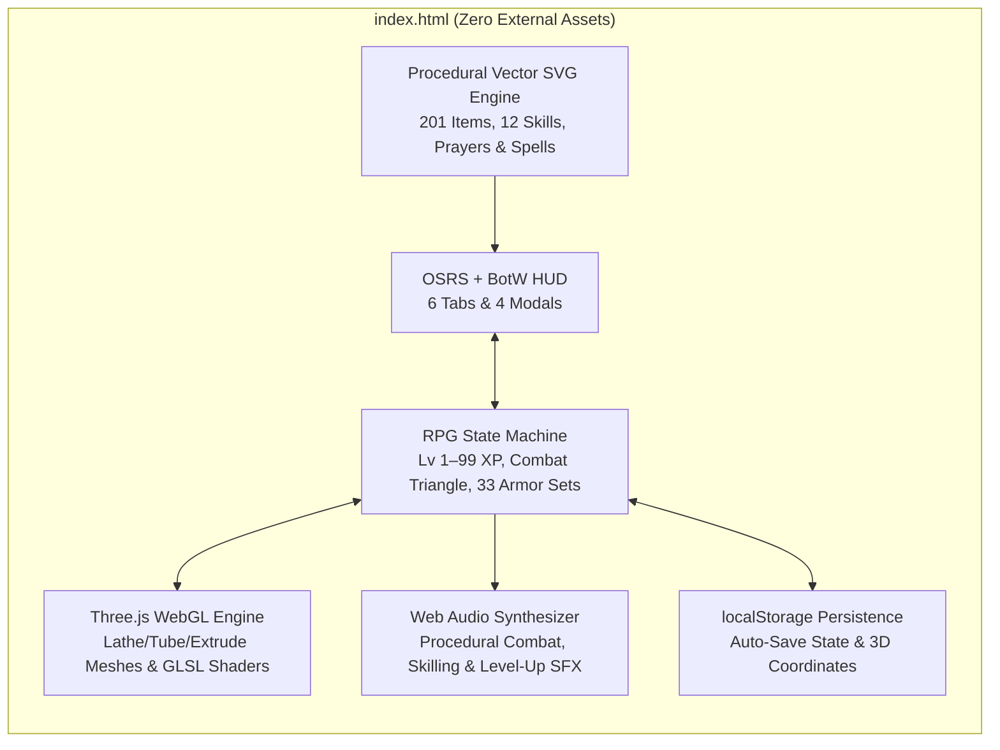

<div align="center">


# RuneWilds: Breath of Gielinor

**A Zero-Dependency, Single-File 3D Open-World Action RPG**  
*Combining OldSchool RuneScape (OSRS) mechanics & progression with Zelda: Breath of the Wild 3D aesthetics*

[](https://gielinor-hero.vercel.app/)
[](https://allansli.github.io/osrs-like/)
[](https://threejs.org/)
[-f59e0b?style=for-the-badge)](#item--equipment-progression-201-items--33-matched-sets)
[](./LICENSE)

[**Play Live in Browser**](https://allansli.github.io/osrs-like/) • [**Features**](#key-features) • [**World Regions**](#world-regions--monsters) • [**Controls**](#controls--quick-start) • [**Architecture**](#engine-architecture)

</div>

---

## Overview

**RuneWilds: Breath of Gielinor** is a complete 3D open-world RPG built inside a single self-contained HTML file ([`index.html`](./index.html)) with zero external assets or build steps required. Everything—from the custom GLSL sky and water shaders to the 201 vector SVG item icons, sculpted 3D meshes, OSRS experience curves, and Web Audio sound effects—is generated procedurally at runtime.

---

## Key Features

### 1. Smooth 3D Graphics & Custom GLSL Shaders
- **Volumetric Sky Dome Shader**: Custom GLSL fragment shader with Fractal Brownian Motion (FBM) drifting clouds, sun disc corona, and 3 dynamic lighting cycles (**Golden Hour**, **High Noon**, and **Starry Night**).
- **Animated Water Shader**: Custom GLSL vertex & fragment water shader along the winding River Lum with wave displacement and specular sun shimmer.
- **Organic Sculpted 3D Geometry**:
  - Contoured `LatheGeometry` character torsos, flared tunics, marble chalice altars, castle towers, and Sheikah teleport shrines with floating gyroscopic rings.
  - Curved `CatmullRomCurve3` + `TubeGeometry` tree trunks and branches with billowing multi-sphere canopies and 1,400 instanced tapered grass blades.
  - Beveled `ExtrudeGeometry` scimitars, longswords, greatswords, and kiteshields.
- **Smooth Chase Camera**: Behind-character third-person camera with smooth `lerp` tracking, mouse-drag/keyboard orbit, zoom, and soft `PCFSoftShadowMap` shadows.

### 2. Full OldSchool RuneScape Mechanics
- **12 Trainable Skills (Levels 1–99)**:
  - **Combat**: *Attack*, *Strength*, *Defence*, *Hitpoints*, *Ranged*, *Magic*, *Prayer*
  - **Gathering & Artisan**: *Woodcutting*, *Mining*, *Smithing*, *Fishing*, *Cooking*
- **Official OSRS Experience Curve**: Exact OSRS XP formula from Level 1 (`0 XP`) to Level 99 (`13,034,431 XP`), with an interactive **XP Table Modal** and a toggleable **10x League XP / 1x Classic OSRS** rate switch.
- **Combat Triangle & Special Attacks**:
  - Switch between *Accurate (Slash)*, *Aggressive (Lunge)*, *Defensive (Parry)*, *Rapid Ranged*, and *Autocast Magic* (*Wind Strike*, *Fire Bolt*, *Ancient Ice Burst*, *Blood Barrage*).
  - **Hylian Spin-Slash Special Attack** (25% Special Energy) with 360° shockwave cleave.
  - **8 Prayers** including overhead protections (*Protect from Melee*, *Protect from Magic*, *Protect from Ranged*, *Hylian Piety*) rendered above your character's head.
- **Rotating Radar Minimap**: Live 2D canvas minimap rotating with camera yaw, displaying rivers, stone roads, trees (green), ore veins (cyan), NPCs/Altars/Forges (gold), and monsters (red).

### 3. Item & Equipment Progression (201 Items & 33 Matched Sets)
- **Zero Emojis — 100% Bespoke Vector SVG Artwork**: Every item, skill, prayer, spell, and HUD element uses a custom multi-layered SVG vector renderer dynamically shaded with each item's metallic and trim colors.
- **Full 10-Slot Equipment Paperdoll**: `Head`, `Cape`, `Neck`, `Weapon`, `Body` (Top), `Shield`, `Legs` (Bottom), `Hands`, `Feet`, and `Ring`—all reflected visually on your 3D character in real time.
- **33 Matched Top (`body`) & Bottom (`legs`) Armor Sets (+10% Set Bonus)**:
  - Every single chestpiece/tunic/robetop has an exact 1-to-1 matching leg armor piece (`66` paired Top & Bottom items across 33 sets). Equipping a matching Top + Bottom activates a **+10% Matched Set Bonus** to all combat stats:
    - **Melee & Knight Sets**: *Hylian Traveler*, *Bronze*, *Iron*, *Steel*, *Black Knight*, *White Knight Proselyte*, *Mithril*, *Adamant*, *Rune*, *Gilded Treasure*, *Granite Fortress*, *Dragon*, *Dharok's Barrows*, *Torag's Barrows*, *Bandos War God*, *Justiciar Paladin*, *Inquisitor's*, and *Torva Ancient*.
    - **Hyrule Legend Sets**: *Champion of Hyrule*, *Zora Royal Domain*, and *Fierce Deity*.
    - **Ranged Sets**: *Green D'hide*, *Blue D'hide*, *Red D'hide*, *Black D'hide*, *Sheikah Stealth*, *Armadyl*, and *Masori*.
    - **Magic Sets**: *Blue Wizard*, *Mystic*, *Infinity*, *Ahrim's Barrows*, and *Ancestral Archmage*.
- **Pre-Purchase Requirement Badges**: Every shop and forge card displays the exact skill level required to equip or craft the item—color-coded **Green (`Can Equip`)** or **Red (`Your Lv: X`)**—plus a **Can Equip Now** shop filter.

### 4. Automatic `localStorage` Persistence
- Progress is saved automatically on every action, every 2 seconds while exploring, and on page unload (`runewilds_save_v3`):
  - All 12 skill levels & XP, GP pouch, 28-slot inventory, and 10-slot worn equipment
  - Hitpoints, Prayer points, Special Attack energy, active Prayers, combat style, and selected spell
  - Exact 3D world position (`x, y, z`), character yaw, camera angle/zoom, and time-of-day preset

---

## World Regions & Monsters

| Region | Biome | Notable Landmarks & Resources | Monsters |
| :--- | :--- | :--- | :--- |
| **Lumbridge Haven** | Emerald River Valley | Lumbridge Castle, Sacred Altar, Blacksmith Forge & Range, Grand Emporium, River Lum Bridge, Normal/Oak/Willow Trees, Shrimp/Trout Fishing | Plump Chicken (Lv 1), Goblin Raider (Lv 2) |
| **Varrock Grand Plaza** | Royal Trade Capital | Cathedral Prayer Altar, Royal Blacksmith, Trade Master, Copper & Iron Quarry | Dark Wizard (Lv 18), Hill Giant (Lv 28) |
| **Al-Kharid Golden Dunes** | Sunscorched Oasis | Bazaar Merchant, Mithril & Gold Ore Quarry, Desert Shrine | King Scorpion (Lv 12) |
| **Whispering Korok Woods** | Sacred Forest Sanctuary | Sacred Blossom Yew Trees, Magic Korok Trees, Lobster & Mystic Shark Pools | Moss Guardian (Lv 45) |
| **Dragon's Peak Highlands** | Volcanic Obsidian Crag | Runite Ore Veins, Wilderness Shrine | Lesser Demon (Lv 68), **Elvarg the Crag Dragon (Lv 95 Boss)** |

---

## Controls & Quick Start

| Input | Action |
| :--- | :--- |
| **W / A / S / D** or **Arrow Keys** | Move character relative to camera orientation |
| **Left-Click (World)** | Walk to terrain, attack monster, chop tree, mine ore, fish, or interact with Shrine/Altar/Forge/Shop |
| **Right-Click + Drag** or **Q / E** | Orbit camera around character (`N` compass button resets camera behind player) |
| **Mouse Wheel** | Zoom camera in / out |
| **Spacebar** | Jump |
| **F** | Arm / Disarm **Hylian Spin-Slash** Special Attack (25% energy) |
| **Left-Click (Inventory)** | Equip gear, eat food, drink potion, bury bones (or sell item if Grand Emporium is open) |
| **Right-Click (Inventory)** | Quick-sell item immediately for 65% GP value |

---

## Engine Architecture



---

## Running Locally

Because the entire game lives in [`index.html`](./index.html), you can run it directly without installing any packages:

```bash
# Clone the repository
git clone https://github.com/allansli/osrs-like.git
cd osrs-like

# Option 1: Open index.html directly in any browser
start index.html

# Option 2: Serve over local HTTP
npx serve .
```

---

## License

Released under the [MIT License](./LICENSE).
