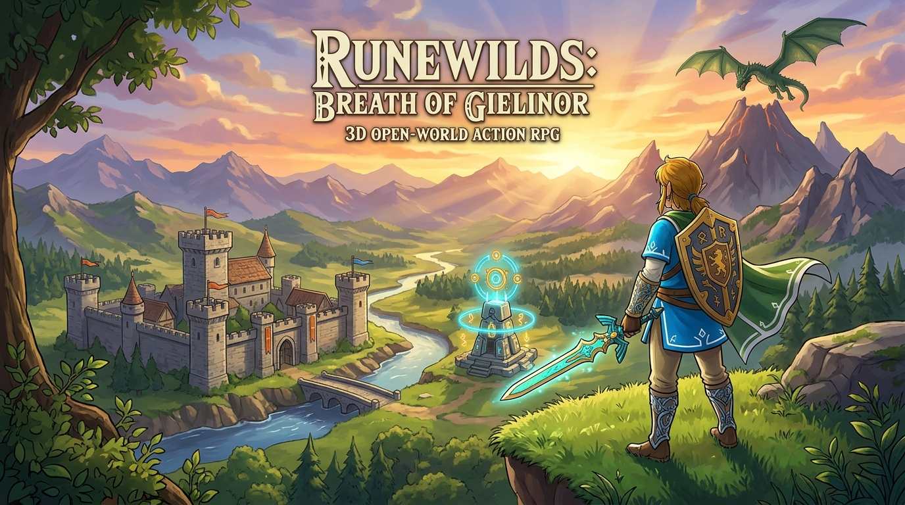
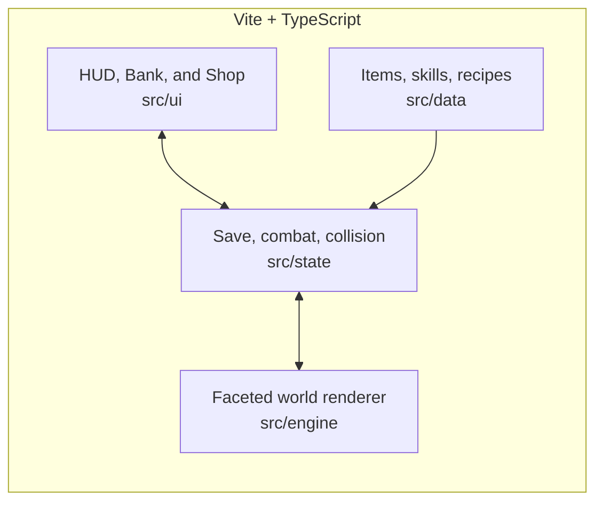

<div align="center">



# Gielinor Hero

**A 3D open-world action RPG**  
*OldSchool RuneScape mechanics and progression in a Breath of the Wild gouache world*

[](https://gielinor-hero.vercel.app/)
[](https://gielinor-hero.vercel.app/)
[](https://threejs.org/)
[-f59e0b?style=for-the-badge)](#item--equipment-progression-260-items--36-matched-sets)
[](./LICENSE)

[**Play Live in Browser**](https://gielinor-hero.vercel.app/) • [**Features**](#key-features) • [**World Regions**](#world-regions--monsters) • [**Controls**](#controls--quick-start) • [**Architecture**](#engine-architecture)

</div>

---

## Overview

**Gielinor Hero** is a 3D open-world RPG. The Vite + TypeScript client keeps the procedural GLSL sky and water, vector item icons, OSRS experience curve, and Web Audio effects, and adds a bank vault, shrine discovery, and faceted gouache rendering.

---

## Key Features

### 1. Smooth 3D Graphics & Custom GLSL Shaders
- **Volumetric Sky Dome Shader**: Custom GLSL fragment shader with Fractal Brownian Motion (FBM) drifting clouds, sun disc corona, and 3 dynamic lighting cycles (**Golden Hour**, **High Noon**, and **Starry Night**).
- **Animated Water Shader**: Custom GLSL vertex & fragment water shader along the winding River Lum with wave displacement and specular sun shimmer.
- **Organic Sculpted 3D Geometry**:
  - Contoured `LatheGeometry` character torsos, flared tunics, marble chalice altars, castle towers, and Sheikah teleport shrines with floating gyroscopic rings.
  - Curved `CatmullRomCurve3` + `TubeGeometry` tree trunks and branches with billowing multi-sphere canopies and 900 instanced tapered grass blades.
  - Beveled `ExtrudeGeometry` scimitars, longswords, greatswords, and kiteshields.
- **Smooth Chase Camera**: Behind-character third-person camera with smooth `lerp` tracking, mouse-drag/keyboard orbit, zoom, and soft `PCFSoftShadowMap` shadows.

### 2. Full OldSchool RuneScape Mechanics
- **12 Trainable Skills (Levels 1–99)**:
  - **Combat**: *Attack*, *Strength*, *Defence*, *Hitpoints*, *Ranged*, *Magic*, *Prayer*
  - **Gathering & Artisan**: *Woodcutting*, *Mining*, *Smithing*, *Fishing*, *Cooking*
- **Official OSRS Experience Curve**: Exact OSRS XP formula from Level 1 (`0 XP`) to Level 99 (`13,034,431 XP`), with an interactive **XP Table Modal** and a toggleable **10x League XP / 1x Classic OSRS** rate switch.
- **Combat Triangle & Special Attacks**:
  - Switch between *Accurate (Slash)*, *Aggressive (Lunge)*, *Defensive (Parry)*, *Rapid Ranged*, and *Autocast Magic* (*Wind Strike*, *Fire Bolt*, *Ancient Ice Burst*, *Blood Barrage*).
  - **Hylian Spin-Slash Special Attack** (25% Special Energy) with 360° shockwave cleave.
  - **8 Prayers** including overhead protections (*Protect from Melee*, *Protect from Magic*, *Protect from Ranged*, *Hylian Piety*) rendered above your character's head.
- **Rotating Radar Minimap**: Live 2D canvas minimap rotating with camera yaw, displaying rivers, stone roads, trees (green), ore veins (cyan), NPCs/Altars/Forges (gold), and monsters (red).

### 3. Item & Equipment Progression (260 Items & 36 Matched Sets)
- **Zero Emojis — 100% Bespoke Vector SVG Artwork**: Every item, skill, prayer, spell, and HUD element uses a custom multi-layered SVG vector renderer dynamically shaded with each item's metallic and trim colors.
- **Full 10-Slot Equipment Paperdoll**: `Head`, `Cape`, `Neck`, `Weapon`, `Body` (Top), `Shield`, `Legs` (Bottom), `Hands`, `Feet`, and `Ring`—all reflected visually on your 3D character in real time.
- **36 Matched Top (`body`) & Bottom (`legs`) Armor Sets (+10% Set Bonus)**:
  - Every single chestpiece/tunic/robetop has an exact 1-to-1 matching leg armor piece (`72` paired Top & Bottom items across 36 sets). Equipping a matching Top + Bottom activates a **+10% Matched Set Bonus** to all combat stats:
    - **Melee & Knight Sets**: *Hylian Traveler*, *Bronze*, *Iron*, *Steel*, *Black Knight*, *White Knight Proselyte*, *Mithril*, *Adamant*, *Rune*, *Gilded Treasure*, *Granite Fortress*, *Dragon*, *Dharok's Barrows*, *Torag's Barrows*, *Bandos War God*, *Justiciar Paladin*, *Inquisitor's*, and *Torva Ancient*.
    - **Hyrule Legend Sets**: *Champion of Hyrule*, *Zora Royal Domain*, and *Fierce Deity*.
    - **Ranged Sets**: *Green D'hide*, *Blue D'hide*, *Red D'hide*, *Black D'hide*, *Sheikah Stealth*, *Armadyl*, *Masori*, *Karil's Barrows*, and *Crystal Elven*.
    - **Magic Sets**: *Blue Wizard*, *Mystic*, *Infinity*, *Ahrim's Barrows*, *Ancestral Archmage*, and *Bloodbark*.
- **Pre-Purchase Requirement Badges**: Every shop and forge card displays the exact skill level required to equip or craft the item—color-coded **Green (`Can Equip`)** or **Red (`Your Lv: X`)**—plus a **Can Equip Now** shop filter.

### 4. Automatic `localStorage` Persistence
- Progress is saved every 2 seconds, when the tab is hidden, on exit and on manual save (`gielinor_hero_save_v1`). Older `runewilds_save_v3` and `runewilds_save_v2` saves migrate forward, stacking duplicate resources, runes, and bones.
  - All 12 skill levels & XP, GP pouch, 28-slot backpack, bank vault, and 10-slot worn equipment
  - Hitpoints, Prayer points, Special Attack energy, active Prayers, combat style, and selected spell
  - Exact 3D world position (`x, y, z`), character yaw, camera angle/zoom, and time-of-day preset

---

## World Regions & Monsters

| Region | Biome | Notable Landmarks & Resources | Monsters |
| :--- | :--- | :--- | :--- |
| **Lumbridge Haven** | Emerald River Valley | Lumbridge Castle, Sacred Altar, Blacksmith Forge & Range, Grand Emporium, River Lum Bridge, Normal/Oak/Willow Trees, Shrimp/Trout Fishing, Three Kettle Camp | Plump Chicken (Lv 1) x4, Goblin Raider (Lv 2) x5, Goblin Archer (Lv 5) x2 (both camps passive) |
| **Varrock Grand Plaza** | Royal Trade Capital | Cathedral Prayer Altar, Royal Blacksmith, Trade Master, Copper & Iron Quarry; Millrace Road ends at its shrine | Dark Wizard (Lv 18) x3, Dark Ranger (Lv 24) x2, Hill Giant (Lv 28) x4 (all aggressive) |
| **Al-Kharid Golden Dunes** | Sunscorched Oasis | Bazaar Merchant, Mithril & Gold Ore Quarry, Desert Shrine, Tamarisk Pool (fishing); Saltwind Track ends at its shrine | King Scorpion (Lv 12) x5 in two nests (aggressive) |
| **Whispering Korok Woods** | Sacred Forest Sanctuary | Sacred Blossom Yew Trees and Magic Korok Trees (deep woods only), Lobster & Mystic Shark Pools, Reedglass Tarn (fishing), Lampwright's Hollow; Lanternway ends at its shrine | Moss Guardian (Lv 45) x4 in two deep-woods camps (aggressive) |
| **Dragon's Peak Highlands** | Volcanic Obsidian Crag | Runite Ore Veins, Wilderness Shrine, Wardstone Cairn, Slagfall Terrace; Harrowback Ridge walls off the crag and Cinderstep Pass is its only gap; Cinder Stair ends at its shrine | Lesser Demon (Lv 68) x6 (four pass sentries, two at Slagfall Terrace), **Elvarg the Crag Dragon (Lv 95 Boss)** x1 (all aggressive) |

The world spawns 36 monsters of 10 types; the number after each monster is how many spawn in that region. Every camp is aggressive except the hen yard and Three Kettle Camp: aggressive monsters notice a player within 9 units (melee) or 12 units (ranged and magic).

### New places

Twelve names were added to the world.

| Kind | Name | Where |
| :--- | :--- | :--- |
| Path | **Millrace Road** | Lumbridge to the Varrock shrine |
| Path | **Saltwind Track** | Fork at the road to the Al-Kharid shrine |
| Path | **Lanternway** | Lumbridge to the Korok Woods shrine |
| Path | **Cinder Stair** | Lumbridge to the Wilderness shrine, through the pass |
| Ridge | **Harrowback Ridge** | Closes the volcanic corner; one gap, Cinderstep Pass |
| Pass | **Cinderstep Pass** | The only way through the ridge, held by four lesser demon sentries |
| Water | **Reedglass Tarn** | Basin in the Korok Woods, with a trout spot |
| Water | **Tamarisk Pool** | Basin in the dunes, with a shrimp spot |
| Place | **Three Kettle Camp** | Goblin camp beside Lumbridge |
| Place | **Wardstone Cairn** | Warning cairn before the pass |
| Place | **Slagfall Terrace** | Lesser demon terrace in the crag |
| Place | **Lampwright's Hollow** | Lantern clearing in the Korok Woods |

---

## Controls & Quick Start

| Input | Action |
| :--- | :--- |
| **W / A / S / D** or **Arrow Keys** | Move character relative to camera orientation |
| **Left-Click (World)** | Walk to terrain, attack monster, chop tree, mine ore, fish, or walk up to the Bank, General Store, Anvil, Shrine, or Altar |
| **F1–F6** | Switch the Combat, Skills, Inventory, Equipment, Prayer, and Magic panels |
| **Esc** | Close the open window |
| **Right-Click + Drag** or **Q / E** | Orbit camera around character (`N` compass button resets camera behind player) |
| **Mouse Wheel** | Zoom camera in / out |
| **Spacebar** | Jump |
| **F** | Arm / Disarm **Hylian Spin-Slash** Special Attack (25% energy) |
| **Left-Click (Inventory)** | Equip gear, eat food, drink potion, bury bones (or sell item if Grand Emporium is open) |
| **Right-Click (Inventory)** | Quick-sell item immediately for 65% GP value |

---

## Engine Architecture



---

## Running Locally

```bash
npm install
npm run dev
npm test
npm run build
```

`npm run dev` serves the game locally. `npm test` runs the Vitest suite for saves, stacking, combat styles, shrines, collision, and log crafting. `npm run build` typechecks and writes `dist/`.

---

## Credits

The game uses third-party 3D assets from Blend Swap. Two are under Creative Commons Attribution 3.0 (CC-BY 3.0) and need credit:

- "Dragon Rig And Textures" (the dragon) by yoji, CC-BY 3.0, http://www.blendswap.com/blends/view/21036
- "Game Anime RPG Character" (Kai, the player character) by uchiha007, CC-BY 3.0, http://www.blendswap.com/blends/view/26667

The guard is "Rigged Knight in Armor" by Xali, Blend Swap blend 28541, CC0. [CREDITS.md](./CREDITS.md) lists every third-party asset with its title, author, source and licence.

---

## License

Released under the [MIT License](./LICENSE). The MIT License covers the code only; the third-party assets listed in [CREDITS.md](./CREDITS.md) keep their own licences.
